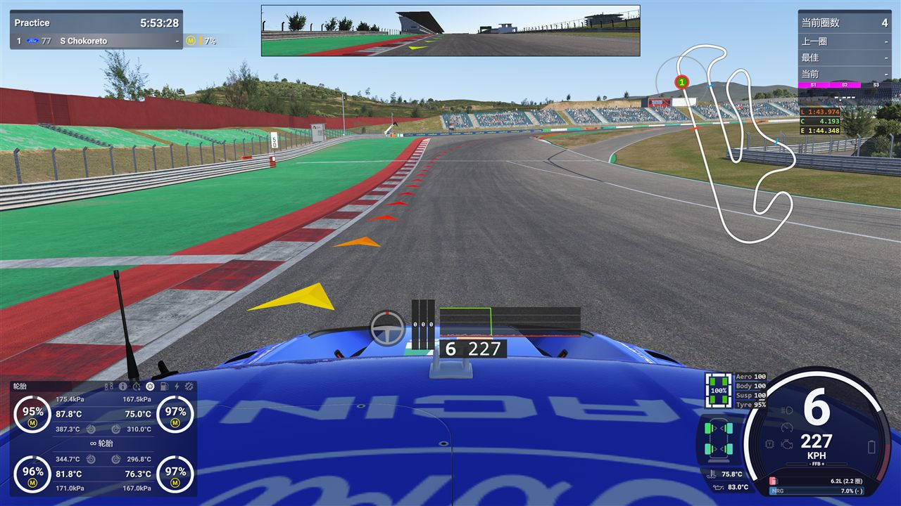
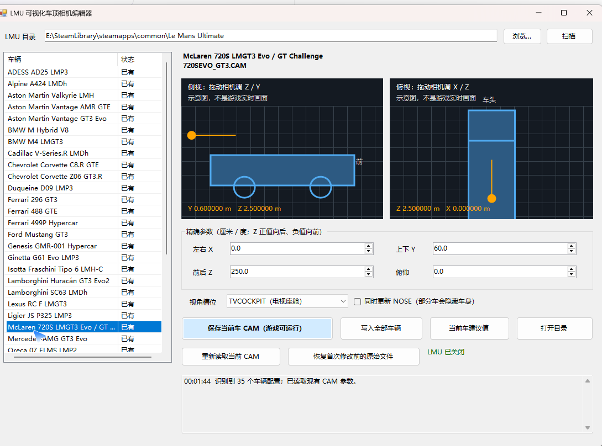

# LMU Roof Camera Studio

A visual editor for **Le Mans Ultimate** camera config files (`.CAM`). It puts an on-board / roof camera exactly where you want it, and keeps the car body visible in the frame.

Unofficial tool. Not affiliated with Motorsport Games or Studio 397.



## The editor



## Features

- **Drag to aim** — move the orange camera dot in a side view (Y/Z) and a top view (X/Z); no numbers to memorise.
- **Precise input** — fields are in centimetres and degrees and are converted to metres / radians on write.
- **Install for every car at once** — reads the game's vehicle list and real `.CAM` filenames, so there is no manual renaming or hunting for folders.
- **Per-car profiles** — one `.CAM` per car, fully independent.
- **Save while the game is running** — after the one-time setup, only `.CAM` files are touched; `Settings.JSON` is never rewritten.
- **Automatic backup and restore** — originals are backed up before the first change and can be restored in one click.

## Quick start

1. Close Le Mans Ultimate (needed only the first time).
2. Run `dist/LMU可视化车顶相机编辑器.exe`. It uses the built-in .NET Framework, so no extra runtime is required.
3. Confirm the game folder and press **扫描 / Scan**.
4. Pick a car, drag the orange dot or type values.
5. Press **保存当前车 CAM / Save this car** or **写入全部车辆 / Write all cars**.
6. Start the game, enter a track session, and switch to **TVCOCKPIT** (the roof / TV cockpit view).

If `Broadcast Custom Cameras` was off, the first save enables it in `Settings.JSON` (the file is backed up first). That step requires the game to be closed.

## Parameters

| Field | Unit | Meaning |
| --- | --- | --- |
| X | cm | positive = right |
| Y | cm | positive = up |
| Z | cm | **positive = rearward, negative = forward** (measured in game) |
| Pitch | degrees | negative usually looks down |
| Camera slot | — | `TVCOCKPIT` (roof / TV cockpit) or `ONBOARD000` (external on-board) |
| NOSE | — | optional extra slot; some cars do not draw bodywork in it |

Default starting point (verified: the whole car body stays visible):

```
X=0, Y=60 cm, Z=250 cm, pitch=0°, slot=TVCOCKPIT
```

To sit further back keep increasing Z in 5–25 cm steps; to get closer to the roof reduce Z. The −500…+500 cm range in the UI is a tool limit, not an engine limit.

## Where the values live

Pressing **Save this car** writes directly to `UserData\Cameras\<car>.CAM` inside the game folder, so the setting exists **only on the machine that saved it**. The program ships no per-car numbers — a new PC or a reinstall means saving again. To back up your own tuning, copy the whole `UserData\Cameras` folder.

## Tuning while the game runs

1. Keep the game running and Alt+Tab to the editor.
2. Change values and press **Save this car**. Only the `.CAM` is written — `Settings.JSON` is untouched.
3. Back in game, **restart the track session** (or return to the main menu and re-enter).

Sitting in the pit box, changing view, or pausing does not reload the camera. A full game restart is normally unnecessary.

## Backup and restore

Backups live in `%LOCALAPPDATA%\LMUCamStudio\Backups`.

Only files the tool actually changed or created are listed:

- existing `.CAM` / `Settings.JSON` are restored to their pre-change content;
- files created by the tool are deleted;
- anything not in the list is left alone.

Restore with the game closed, since `Settings.JSON` may be involved.

## Online play

The tool only edits local camera configuration. It does not change car performance, physics, fuel, or any race data — camera placement is a visual setting.

It has been verified working in online sessions. Different events or servers may still have their own rules, so check before entering.

## Known limitations

- **No live in-race editing.** `.CAM` is not reliably hot-reloaded; you must reload the track session.
- In-game seat forward/up keys only affect the interior COCKPIT view, not TVCOCKPIT / NOSE / ONBOARD.
- No process memory access, no injection, no anti-cheat bypass.
- The vehicle list comes from `vehicle_settings.json` plus the game's trace logs; a car you have never driven may not appear until the game records it.
- How much bodywork is drawn depends on the slot and the car model — the tool can change the slot and the position, not the model.

## Build from source

Windows' built-in .NET Framework compiler is enough; Visual Studio is not required:

```powershell
powershell -ExecutionPolicy Bypass -File build.ps1
```

Manual build:

```powershell
& "$env:WINDIR\Microsoft.NET\Framework64\v4.0.30319\csc.exe" /target:winexe /platform:anycpu `
  /out:"dist\LMU可视化车顶相机编辑器.exe" `
  /reference:System.dll /reference:System.Core.dll /reference:System.Drawing.dll /reference:System.Windows.Forms.dll `
  "src\LMUCamStudio.cs"
```

Self test (isolated temp folder, never touches a real game install):

```powershell
& ".\dist\LMU可视化车顶相机编辑器.exe" --self-test "$env:TEMP\lmu-selftest.txt"
Get-Content "$env:TEMP\lmu-selftest.txt"
```

## Repository layout

```
src/LMUCamStudio.cs          complete C# source (single-file WinForms)
dist/                        compiled executable
docs/使用说明.md             detailed Chinese guide
docs/screenshot.png          editor window
docs/roof-view.jpg           in-game roof camera result
build.ps1                    one-step build
README.md                    Chinese readme
```

## License

MIT — see [LICENSE](LICENSE).
