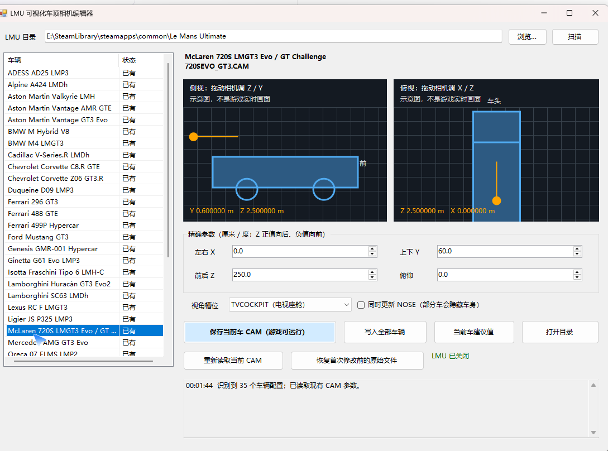

# LMU 可视化车顶相机编辑器

一个给 **Le Mans Ultimate (LMU)** 用的相机配置文件（`.CAM`）可视化编辑器：把车顶／车载视角的位置改到合适的地方，并且能看见车身。

> 非官方工具，与 Motorsport Games / Studio 397 无关。只在**单机**使用，风险自负。



## 它能做什么

- **侧视／俯视拖动**：直接拖动橙色相机点，改上下、前后、左右，不用记数字。
- **精确输入**：数值框以厘米和角度为单位，写入时自动换成米和弧度。
- **一键装到所有车**：自动读取游戏车辆清单和真实 CAM 文件名，不用手动改名、不用找目录。
- **逐车独立参数**：每辆车一份 CAM，互不影响。
- **游戏运行中可保存**：首次启用后，日常微调只改 CAM，不必退出游戏。
- **自动备份与恢复**：第一次改动前备份原始 Settings 和 CAM，可一键还原。
- **720S 专用预设**：默认切到 `ONBOARD000` 外部车载槽位，解决“参数有效但看不到车”的问题。

## 快速开始

1. 完全退出 LMU。
2. 运行 `dist/LMU可视化车顶相机编辑器.exe`（Windows 自带 .NET Framework，无需另装运行库）。
3. 确认游戏目录，点“扫描”。
4. 选车，拖动橙色点或填数值。
5. 点“保存当前车 CAM”，或“写入全部车辆”。
6. 启动游戏，进入赛道，切到 **TVCOCKPIT（电视座舱）**；用 720S 预设时切到 **ONBOARD000（车载 1）**。

首次保存时如果 `Broadcast Custom Cameras` 是关闭的，工具会自动打开并备份 `Settings.JSON`。这一步必须关闭游戏。

## 参数说明

| 参数 | 单位 | 说明 |
| --- | --- | --- |
| 左右 X | cm | 正值向右 |
| 上下 Y | cm | 正值抬高 |
| 前后 Z | cm | **正值向后，负值向前**（720S 实测） |
| 俯仰 | 度 | 负值一般向下 |
| 视角槽位 | — | `TVCOCKPIT` 或 `ONBOARD000` |
| NOSE | — | 可选附加槽位；部分车会隐藏车身，720S 不建议 |

常见起点：

- 大多数车：`X=0, Y=90, Z=65, 俯仰=-8°, TVCOCKPIT`
- 720S（要看见车身）：`X=0, Y=55, Z=15, 俯仰=-11.5°, ONBOARD000`，近裁剪 0.01 m

> 关于 Z 方向：方向和数值符号由游戏内部相机坐标系决定，本工具按 720S 的实测结果（+Z 向后）标注。其他车辆若方向不同，以实际画面为准。

## 720S “参数生效但看不到车”怎么办

这是槽位渲染规则的问题，不是位置没调对。改用随车外部视角：

1. 选中 720S，点“当前车建议值”（槽位会自动设为 `ONBOARD000`）。
2. 保存 CAM，重新加载比赛会话。
3. 游戏内切到 **ONBOARD000／车载 1**，不要用 TVCOCKPIT 或 NOSE。
4. 车身出现后再微调位置：要更靠后就把 Z 加大。

## 游戏运行中怎么微调

1. 保持游戏运行，Alt+Tab 到编辑器。
2. 改参数，点“保存当前车 CAM”。**此时只写 CAM，不碰 Settings.JSON**。
3. 回游戏，**重新进入或重启赛道会话**。

只回 P 房、只切视角、只暂停都不会重新读取 CAM；中止当前会话并重新开始是必要的。不需要完全退出游戏。

## 备份与恢复

备份目录：`%LOCALAPPDATA%\LMUCamStudio\Backups`

工具只把真正改过或新建的文件加入恢复清单：

- 原来存在的 CAM／Settings.JSON 恢复为第一次修改前的内容；
- 工具新建的文件会被删除；
- 其他文件不动。

恢复需要关闭游戏（可能涉及 Settings.JSON）。

## 从源码构建

需要 Windows 自带的 .NET Framework 编译器，不需要 Visual Studio：

```powershell
powershell -ExecutionPolicy Bypass -File build.ps1
```

或手动：

```powershell
& "$env:WINDIR\Microsoft.NET\Framework64\v4.0.30319\csc.exe" /target:winexe /platform:anycpu `
  /out:"dist\LMU可视化车顶相机编辑器.exe" `
  /reference:System.dll /reference:System.Core.dll /reference:System.Drawing.dll /reference:System.Windows.Forms.dll `
  "src\LMUCamStudio.cs"
```

自测（隔离临时目录，不碰真实游戏配置）：

```powershell
& "dist\LMU可视化车顶相机编辑器.exe" --self-test "$env:TEMP\lmu-selftest.txt"
Get-Content "$env:TEMP\lmu-selftest.txt"
```

## 已知限制

- **不能游戏内实时变**。`.CAM` 不会被可靠热重载，必须重进赛道会话。
- 游戏内“座椅前后／上下”按键只对车内 COCKPIT 有效，对 TVCOCKPIT／NOSE／ONBOARD 无效。
- 不做进程内存读写、不做注入、不绕过反作弊。LMU 开启 EAC 时会直接拒绝外部读取游戏进程。
- 车辆清单来自 `vehicle_settings.json` 与 Trace 日志；全新或未出现过的车辆需要先在游戏里跑一次才会被识别。
- 视角槽位的可见车身程度由车模和游戏决定，工具只能换槽位和位置，不能改模型本身。

## 文件结构

```
src/LMUCamStudio.cs          完整 C# 源码（WinForms，单文件）
dist/                        编译好的可执行文件
docs/使用说明.md             中文详细说明
docs/screenshot.png          界面截图
build.ps1                    一键编译
README.en.md                 English readme
```

## 免责声明

修改相机配置属于客户端本地设置，请在单机模式使用。不要在联机比赛中使用任何非官方修改。使用本工具造成的封禁、存档异常或其他后果由使用者承担。仓库不包含游戏本体资源。

## License

MIT，见 [LICENSE](LICENSE)。
