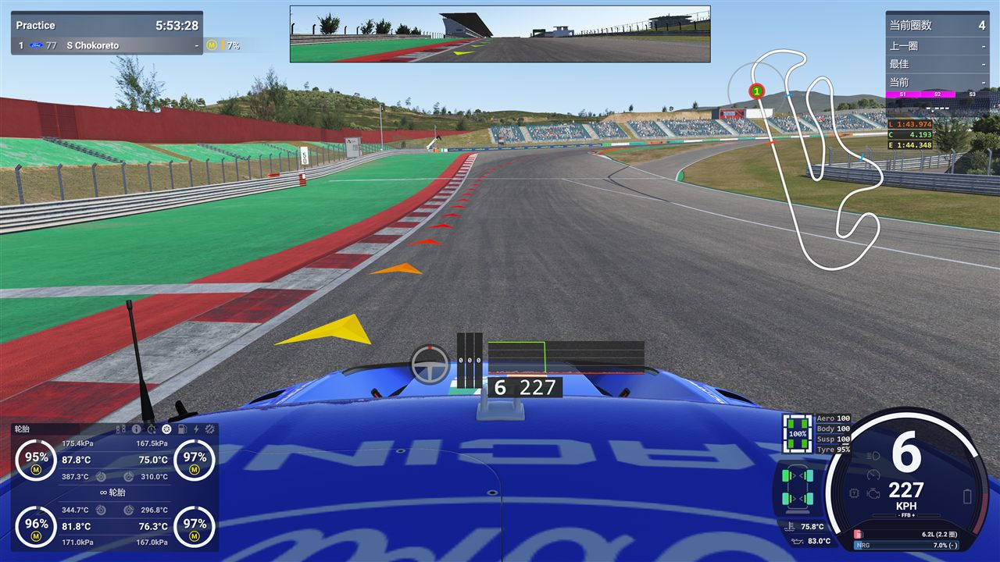

# LMU 可视化车顶相机编辑器

一个给 **Le Mans Ultimate (LMU)** 用的相机配置文件（`.CAM`）可视化编辑器：把车顶／车载视角放到你想要的位置，并让车身正常出现在画面里。

非官方工具，与 Motorsport Games / Studio 397 无关。



## 工具界面


## 它能做什么

- **侧视／俯视拖动**：直接拖动橙色相机点，调上下、前后、左右，不用记数字。
- **精确输入**：数值框以厘米和角度为单位，写入时自动换成米和弧度。
- **一键装到全部车辆**：自动读取游戏车辆清单和真实 CAM 文件名，不用手动改名、不用找目录。
- **逐车独立参数**：每辆车一份 CAM，互不影响。
- **游戏运行中可保存**：首次启用后，日常微调只改 CAM，不必退出游戏。
- **自动备份与恢复**：第一次改动前备份原始 Settings 和 CAM，可一键还原。

## 快速开始

1. 完全退出 LMU（仅首次需要）。
2. 运行 `dist/LMU可视化车顶相机编辑器.exe`（Windows 自带 .NET Framework，无需另装运行库）。
3. 确认游戏目录，点“扫描”。
4. 选车，拖动橙色点或填数值。
5. 点“保存当前车 CAM”，或“写入全部车辆”。
6. 启动游戏，进入赛道，切到 **TVCOCKPIT（电视座舱／车顶视角）**。

首次保存时如果 `Broadcast Custom Cameras` 是关闭的，工具会自动打开并备份 `Settings.JSON`。这一步必须关闭游戏。

## 参数说明

| 参数 | 单位 | 说明 |
| --- | --- | --- |
| 左右 X | cm | 正值向右 |
| 上下 Y | cm | 正值抬高 |
| 前后 Z | cm | **正值向后，负值向前**（实测） |
| 俯仰 | 度 | 负值一般向下 |
| 视角槽位 | — | `TVCOCKPIT`（车顶／电视座舱）或 `ONBOARD000`（随车外部） |
| NOSE | — | 可选附加槽位；部分车会隐藏车身 |

默认起点（实测可完整看到车身）：

```
X=0, Y=60 cm, Z=250 cm, 俯仰=0°, 槽位=TVCOCKPIT
```

要更靠后就把 Z 继续加大，每次 5～25 cm；想更贴近车顶就减小 Z。界面范围 −500～+500 cm 只是工具限制，不是引擎上限。

## 游戏运行中怎么微调

1. 保持游戏运行，Alt+Tab 到编辑器。
2. 改参数，点“保存当前车 CAM”。**此时只写 CAM，不碰 Settings.JSON**。
3. 回游戏，**重新进入或重启赛道会话**。

只回 P 房、只切视角、只暂停都不会重新读取 CAM。不需要完全退出游戏。

## 参数存在哪

点“保存当前车 CAM”时，数值直接写进游戏目录的 `UserData\Cameras\<车辆名>.CAM`，**只在你这台机器上生效**。程序本身不携带任何一辆车的参数，换个电脑或重装游戏都要重新保存一次。要备份自己的调参结果，复制 `UserData\Cameras` 整个目录即可。

## 备份与恢复

备份目录：`%LOCALAPPDATA%\LMUCamStudio\Backups`

工具只把真正改过或新建的文件加入恢复清单：

- 原来存在的 CAM／Settings.JSON 恢复为第一次修改前的内容；
- 工具新建的文件会被删除；
- 其他文件不动。

恢复建议关闭游戏（可能涉及 Settings.JSON）。

## English

See [README.en.md](README.en.md) for the full English introduction.

## 关于联机

工具只修改本地相机配置文件，不改变车辆性能、物理、燃油或任何判定数据。

相机视角属于画面设置，修改本身不涉及性能优势。已在联机模式实测可用；不同赛事或服务器可能有各自的规则，入场前自行确认。

## 已知限制

- **不能游戏内实时变**。`.CAM` 不会被可靠热重载，必须重进赛道会话。
- 游戏内“座椅前后／上下”按键只对车内 COCKPIT 有效，对 TVCOCKPIT／NOSE／ONBOARD 无效。
- 不做进程内存读写、不做注入、不绕过反作弊。
- 车辆清单来自 `vehicle_settings.json` 与 Trace 日志；从未开过的车需要先在游戏里跑一次。
- 视角槽位的车身显示程度由车模和游戏决定，工具只能换槽位和位置，不能改模型本身。

## 从源码构建

需要 Windows 自带的 .NET Framework 编译器，不需要 Visual Studio：

```powershell
powershell -ExecutionPolicy Bypass -File build.ps1
```

自测（隔离临时目录，不碰真实游戏配置）：

```powershell
& ".\dist\LMU可视化车顶相机编辑器.exe" --self-test "$env:TEMP\lmu-selftest.txt"
Get-Content "$env:TEMP\lmu-selftest.txt"
```

## 文件结构

```
src/LMUCamStudio.cs          完整 C# 源码（WinForms，单文件）
dist/                        编译好的可执行文件
docs/使用说明.md             中文详细说明
docs/screenshot.png          工具界面截图
docs/roof-view.jpg           游戏内车顶视角效果
build.ps1                    一键编译
README.en.md                 English readme
```

## License

MIT，见 [LICENSE](LICENSE)。
